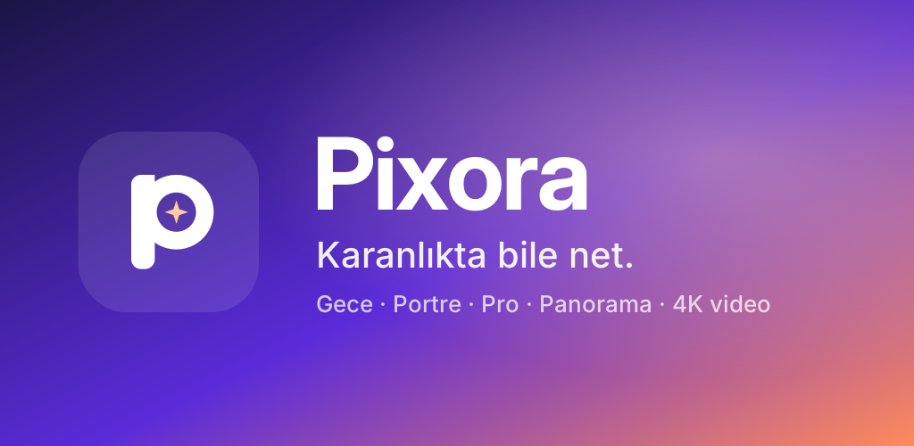

  

<h1 align="center">Pixora</h1>

<b>Karanlıkta bile net.</b> · <i>Clear, even in the dark.</i>

  Android için reklamsız, açık kaynaklı kamera uygulaması 
  <a href="#-türkçe">Türkçe</a> · <a href="#-english">English</a> · <a href="docs/DEVELOPMENT.md">Geliştiriciler / Developers</a>

---

## 🇹🇷 Türkçe

Pixora, telefonunun kamerasından daha fazlasını çıkarmak için yapılmış bir kamera uygulaması. Reklam yok,
hesap yok, internet izni yok: fotoğrafların telefonundan hiç çıkmaz.

### Öne çıkanlar

| | |
|---|---|
| 🌙 **Gece** | Tek kare yerine art arda kareler çeker, hareketli bölgeleri koruyarak birleştirir, gürültüyü akıllıca azaltır. Destekleyen telefonlarda ham (RAW) kareleri birleştirir. |
| ✨ **Yıldız** | Telefon sabitken saniyeler süren uzun pozlamalarla gökyüzünü çeker, sıcak pikselleri temizler. Yalnızca uzun pozlamayı destekleyen telefonlarda görünür. |
| 👤 **Portre** | Telefonda çalışan yapay zekâ derinlik haritasıyla doğal arka plan bulanıklığı. |
| 🎛️ **Pro** | Pozlama (EV), beyaz dengesi, renk profilleri (Doğal, Monokrom, Flat Log), canlı histogram. Telefon izin veriyorsa ISO, enstantane ve elle odak. |
| 🌄 **Panorama** | Jiroskop rehberliğinde çek, Pixora otomatik birleştirsin. |
| 🎬 **Video** | Telefonun desteklediği ölçüde 4K'ya kadar, H.264 veya H.265. Hızlandırılmış çekim (time-lapse). |
| 🔒 **Gizlilik** | İnternet izni yok. Yapay zekâ işlemleri cihazda. Konum etiketi isteğe bağlı, varsayılan kapalı. |

**Ayrıca:** ultra geniş / ana / 2x geçişi · dokunarak odak ve pozlama · uzun basarak AF/AE kilidi ·
ızgara (3x3, kare, altın oran) · zamanlayıcı · flaş · ses tuşlarıyla çekim · destekleyen telefonlarda RAW (DNG) ·
sahne algılama.

### Uyumluluk
Android 9 ve üzeri. RAW, elle ISO/enstantane, 60 FPS ve video sabitleme gibi özellikler telefonun kamera
donanımının uygulamalara izin vermesine bağlıdır. Pixora telefonunda olmayan seçenekleri otomatik gizler,
böylece çalışmayan bir düğmeyle karşılaşmazsın.

### İndir
Google Play sürümü hazırlanıyor. Şimdilik APK dosyasını [Releases](../../releases) sayfasından indirebilirsin.

---

## 🇬🇧 English

Pixora is a camera app built to get more out of your phone's camera. No ads, no account, no internet
permission: your photos never leave your phone.

### Highlights

| | |
|---|---|
| 🌙 **Night** | Captures a burst of frames instead of one, merges them while protecting moving areas, and removes noise intelligently. Merges RAW frames on supported phones. |
| ✨ **Astro** | With the phone held still, takes multi-second long exposures of the night sky and removes hot pixels. Shown only on phones that support long exposures. |
| 👤 **Portrait** | Natural background blur powered by an on-device AI depth map. |
| 🎛️ **Pro** | Exposure (EV), white balance, color profiles (Natural, Monochrome, Flat Log), live histogram. ISO, shutter and manual focus where your phone allows. |
| 🌄 **Panorama** | Gyroscope-guided capture with automatic stitching. |
| 🎬 **Video** | Up to 4K where supported, H.264 or H.265. Time-lapse. |
| 🔒 **Privacy** | No internet permission. All AI runs on the device. Location tagging is optional and off by default. |

**Also:** ultra-wide / main / 2x switching · tap to focus and expose · long-press AF/AE lock ·
grid (3x3, square, golden ratio) · timer · flash · volume-key shutter · RAW (DNG) on supported phones ·
scene detection.

### Compatibility
Android 9 and newer. Features such as RAW, manual ISO/shutter, 60 FPS and video stabilization depend on
whether your phone's camera hardware exposes them to apps. Pixora hides options your phone doesn't support,
so you never hit a button that does nothing.

> The app interface is currently in Turkish. English is on the way.

### Download
A Google Play release is in preparation. For now, grab the APK from the [Releases](../../releases) page.

---

  <a href="docs/DEVELOPMENT.md">Derleme, mimari ve testler / Build, architecture and tests →</a>

